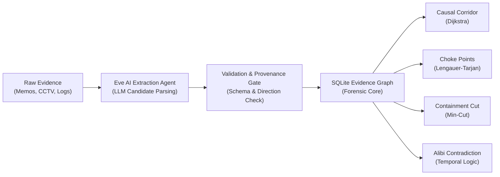

# Graphical Investigation System (GIS)
## Forensic Intelligence Architecture, Mathematical Graph Theory & Operations Manual

---

## 1. System Philosophy & Foundational Invariants

The **Graphical Investigation System (GIS)** is an evidence-constrained, deterministic forensic reasoning engine. It solves the critical limitation of traditional AI investigation tools: **hallucination in deductive logic**.

### The Hybrid Deterministic Architecture
In GIS, artificial intelligence and formal mathematics are strictly decoupled:
* **Probabilistic LLM Layer (Eve AI Agent)**: Operates solely at the **periphery** for natural language fact extraction, parsing unstructured reports into candidate entities, events, timestamps, and relationships.
* **Deterministic Logic Layer (Graph Engine)**: Operates on a controlled graph ontology using proven discrete mathematics (**Dijkstra**, **Lengauer-Tarjan**, **Edmonds-Karp / Dinic**, **ACH**). The AI is never permitted to deduce guilt or simulate causality on its own; every path, choke point, and contradiction is mathematically derived and verifiable in court.

### The Provenance Hard Invariant
> **The Provenance Rule**: *No node or relationship may exist in the operational graph without a cryptographically verified reference to an underlying evidence artifact.*

Unprovenanced hypotheses or assertions are rejected at the graph commit gate.



---

## 2. Controlled Ontology & Schema Directionality

Every fact in the system conforms to a strict mathematical triple `(SourceNode)-[Relationship]->(TargetNode)`.

### 2.1 Node Categories

| Category | Primary Types | Core Attributes |
| :--- | :--- | :--- |
| **`ENTITY`** | `PERSON`, `ORGANIZATION`, `LOCATION`, `VEHICLE`, `DEVICE`, `ACCOUNT`, `SERVER`, `FILE` | `id`, `label`, `category`, `type`, `properties` |
| **`EVENT`** | `INCURSION`, `BREACH`, `MOVEMENT`, `EXFILTRATION`, `COMMUNICATION`, `DATA_ACCESS` | `id`, `label`, `category`, `type`, `time` (ISO-8601 + precision), `properties` |
| **`EVIDENCE`** | `DOCUMENT`, `AUDIO`, `VIDEO`, `FORENSIC_REPORT`, `PHYSICAL` | `id`, `label`, `category`, `type`, `sourceUri`, `hash`, `custodyChain` |

### 2.2 Strict Relationship Matrix & Direction Rules

To prevent logical paradoxes (such as an inanimate object performing an event, or an event preceding its own cause), relationships must obey directional type constraints:

| Source Category | Target Category | Permitted Relationship Types | Forensic Meaning |
| :--- | :--- | :--- | :--- |
| **`ENTITY`** | **`EVENT`** | `PERFORMED`, `PARTICIPATED_IN`, `INITIATED` | Suspect or agent executing an action |
| **`EVENT`** | **`ENTITY`** | `TARGETED`, `AFFECTED`, `ACCESSED`, `CREATED`, `MODIFIED`, `DELETED`, `USED`, `CONNECTED_TO` | Direct consequence of the action upon an object/place |
| **`EVENT`** | **`EVENT`** | `CAUSED`, `PRECEDED`, `DEPENDS_ON` | Causal and temporal chain of the crime |
| **`ENTITY`** | **`ENTITY`** | `OWNS`, `USES`, `LOCATED_AT`, `MEMBER_OF`, `ASSOCIATED_WITH`, `CONTACTED`, `CONNECTED_TO` | Associational and infrastructure network |

---

## 3. Core Graph Forensic Algorithms

```
+-------------------------------------------------------------------------------+
|                             GRAPH INVESTIGATION SUITE                         |
+--------------------------+----------------------------+-----------------------+
|  1. Causal Corridor      |  2. Choke Points           |  3. Containment Cut   |
|  (Constrained Dijkstra)  |  (Lengauer-Tarjan)         |  (Dinic Min-Cut)      |
|  Operational Killchain   |  Single Failure Points     |  Network Interception |
+--------------------------+----------------------------+-----------------------+
```

### 3.1 Causal Corridor (Constrained Shortest Path)
* **Underlying Algorithm**: Dijkstra's algorithm augmented with strict temporal monotonic filtering ($t_i \le t_j$) and relationship cost minimization.
* **Forensic Utility**:
  - Uncovers the most direct operational path between initial infiltration (e.g., *Gate Incursion*) and the criminal objective (e.g., *Vault Breach* or *Exfiltration*).
  - Filters out peripheral clutter (background phones, casual contacts, non-involved witnesses) to provide a clear timeline for trial presentation.

### 3.2 Choke Points (Lengauer-Tarjan Dominator Tree)
* **Underlying Algorithm**: The Lengauer-Tarjan dominator tree algorithm, running in near-linear time $O(m \cdot \alpha(m, n))$.
* **Mathematical Definition**: A node $d$ dominates a node $n$ ($d\ \text{dom}\ n$) if every path from the entry node $r$ to $n$ must traverse $d$.
* **Forensic Utility**:
  - Identifies **indispensable events** in a conspiracy.
  - **Decisive Counterfactual Alibi Testing**: If a suspect successfully establishes an alibi for a dominator event (e.g., proving they were not present when the `Bulkhead Unlock` occurred), all downstream crime hypotheses collapse automatically:
    $$\text{GraphCut}(\text{ChokePoint}) \implies \text{Reachability}(\text{Target}) = \emptyset$$

### 3.3 Containment Cut (Edmonds-Karp / Dinic Max-Flow Min-Cut)
* **Underlying Algorithm**: The Max-Flow Min-Cut Theorem. GIS assigns capacities to edges based on physical transit friction, surveillance density, and channel bandwidth.
* **Forensic Utility**:
  - Answers tactical interdiction questions: *"What is the minimum set of roads, ports, or digital servers to shut down to prevent the stolen assets from crossing the border?"*
  - Maximizes law enforcement leverage while minimizing operational disruption.

### 3.4 Temporal Contradiction & Impossibility Engine
* **Underlying Algorithm**: Directed temporal interval algebra and geographic transit feasibility bounds.
* **Forensic Utility**:
  - Detects alibi fraud automatically.
  - When a suspect presents a receipt or witness claim at $(L_1, T_1)$ while physical evidence (cell tower telemetry, ANPR plate cameras) logs them at $(L_2, T_2)$, GIS verifies if:
    $$\frac{\text{Distance}(L_1, L_2)}{|T_2 - T_1|} > \text{MaxPhysicalSpeed}$$
  - Flags impossible simultaneous co-locations with visual conflict badges.

---

## 4. Operational Walkthrough: Tab-by-Tab Guide

### Tab 1: Graph Canvas (`/`)
* **Purpose**: Primary interactive visualization workbench.
* **Key Capabilities**:
  - **Dagre Hierarchical Layout**: Places events and entities in logical, readable tiers.
  - **Mode Switches**:
    - `Normal`: Standard interactive exploration (pan, zoom, drag, node inspector).
    - `⚡ Causal Corridor`: Select start and end nodes to compute and highlight the shortest causal chain.
    - `🎯 Choke Points`: Highlights critical single-point-of-failure bottleneck events in red/amber.
    - `✂ Containment Cut`: Renders the minimum edge cut required to isolate the exfiltration target.
  - **Node Color Coding**:
    - Light Blue / Cyan: `ENTITY` (Suspects, Vehicles, Locations, Devices)
    - Amber / Orange: `EVENT` (Timestamped actions, breaches, calls)
    - Deep Purple: `EVIDENCE` (Reports, logs, CCTV tapes)

### Tab 2: Evidence Agent (`/ingest`)
* **Purpose**: Ingest raw police reports, transcripts, wiretaps, or security logs into structured graph data.
* **Key Capabilities**:
  - **Eve AI Agent**: Converts free-form text into formal candidates via OpenAI-compatible LLM endpoints (DeepSeek / OpenCode Zen).
  - **Local Persistence**: Drafts and edits persist across reloads via browser `localStorage`.
  - **Preset Samples**: One-click ingestion benchmarks including **Robbery Heist**, **Insider Threat**, **Auth Logs**, and **Witness Statements**.
  - **Extracted Graph Diff**: Previews all extracted entities, timestamped events, and causal links before committing.

### Tab 3: Hypotheses (`/hypotheses`)
* **Purpose**: Analysis of Competing Hypotheses (ACH) methodology, developed by Richards Heuer (CIA).
* **Key Capabilities**:
  - Formulates mutually exclusive theories (e.g., *Hypothesis A: Tyler Finch was an active conspirator* vs *Hypothesis B: Tyler Finch acted under duress*).
  - Evaluates each piece of evidence against each hypothesis as **Consistent**, **Inconsistent**, or **Neutral**.
  - Ranks hypotheses by lowest inconsistency score to mitigate confirmation bias.

### Tab 4: Strategic Planning (`/planning`)
* **Purpose**: Epistemic decision support and next-best-action recommendations.
* **Key Capabilities**:
  - **Entropy Reduction**: Calculates which unverified lead will yield the highest information gain.
  - **Warrant & Subpoena Prioritization**: Recommends targeted investigative steps (e.g. *"Subpoena cell tower records for Tower West-04"*).

### Tab 5: Evaluation Lab (`/evaluation`)
* **Purpose**: Benchmark and audit graph extraction accuracy.
* **Key Capabilities**:
  - Runs precision, recall, and F1-score evaluations against known ground-truth datasets.
  - Verifies that AI extraction correctly captures all entities and temporal edges without omitting crucial connections.

### Tab 6: Resolution Lab (`/resolution`)
* **Purpose**: Entity deduplication, identity resolution, and alias merging.
* **Key Capabilities**:
  - Detects duplicate records (e.g. `Viktor Cole`, `V. Cole`, `Driver Cole`).
  - Uses Jaro-Winkler distance and shared identifier clustering (phone numbers, license plates) to merge identity nodes while preserving provenance history.

---

## 5. Technology Stack & Directory Structure

```
Graphical-Investigation-system/
├── backend/                         # Node.js + Express backend
│   ├── src/
│   │   ├── api/routes/              # Express REST endpoints
│   │   │   ├── cases-routes.ts      # Case lifecycle & persistence
│   │   │   ├── extraction-routes.ts # Eve AI candidate extraction
│   │   │   └── graph-routes.ts      # Graph queries & algorithms
│   │   ├── application/             # Application services
│   │   │   └── ai-extraction-service.ts # LLM prompting & normalization
│   │   ├── domain/                  # Pure forensic business logic
│   │   │   ├── algorithms/          # Dijkstra, Dominators, Min-Cut
│   │   │   ├── types.ts             # Core graph entity & edge types
│   │   │   ├── validation.ts        # Graph schema & direction validator
│   │   │   └── vocabulary.ts        # Controlled vocabulary constants
│   │   └── infrastructure/          # SQLite persistence & migrations
│   │       ├── db.ts                # node:sqlite WAL database
│   │       └── seed-physical-heist.ts # Seed scenarios
│   └── evidence_graph.db            # SQLite embedded database
└── web/                             # Next.js 15 App Router frontend
    ├── app/                         # App pages & layouts
    ├── components/
    │   ├── agent/                   # Ingestion workspace (CaseIngestionView)
    │   ├── canvas/                  # Cytoscape graph canvas & controls
    │   ├── hypotheses/              # ACH hypothesis matrix
    │   ├── planning/                # Strategic planning & contradiction views
    │   ├── evaluation/              # Ground truth benchmarking
    │   └── resolution/              # Entity resolution & merging
    └── types/                       # Shared frontend TypeScript models
```

---

## 6. Standard Operating Procedure for Investigators

```
Step 1: INGEST
Paste raw dispatch logs or witness notes into the Evidence Agent.
Run "Extract Candidate Facts" -> Review Diff -> "Commit to Graph".

Step 2: EXPLORE & VISUALIZE
Open Graph Canvas with Dagre layout.
Verify actors, locations, and timestamped sequence of events.

Step 3: DISCOVER CHOKE POINTS
Toggle "Choke Points" (Dominator Tree).
Identify bottleneck actions required for crime execution.

Step 4: TRACE KILLCHAIN
Toggle "Causal Corridor" from point of entry to point of exit.
Inspect the shortest uninterrupted operational sequence.

Step 5: TEST ALIBIS & HYPOTHESES
Switch to "Strategic Planning" and "Hypotheses".
Confirm alibi validity against ANPR, CCTV, and cell tower telemetry.
```
