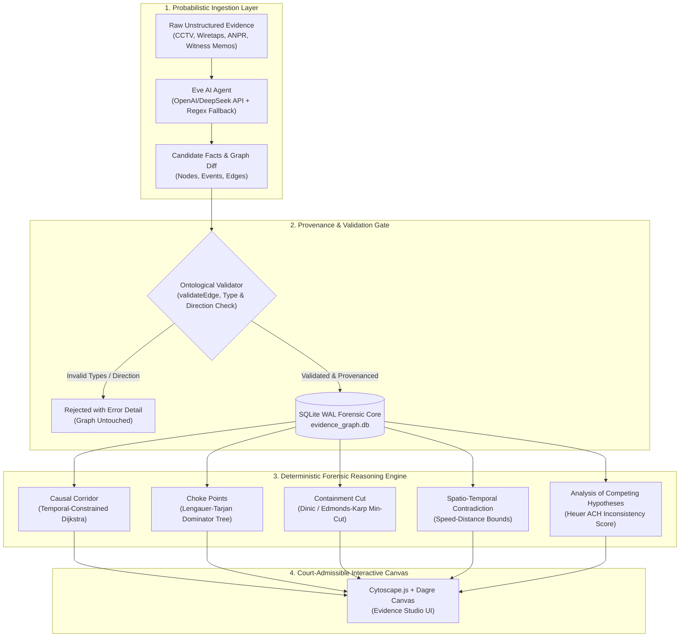
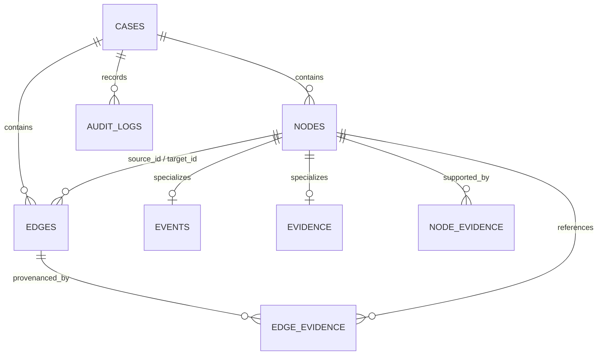

# Graphical Investigation System (GIS)
# Complete Technical Architecture, Forensic Theory & Operational Specification Manual

---

## 1. Executive Summary & Design Invariants

The **Graphical Investigation System (GIS)** is a court-admissible, evidence-constrained forensic reasoning platform. Modern generative AI suffers from deduction hallucination—fabricating links, inventing plausible alibis, or asserting causal relationships without physical proof. GIS solves this by enforcing an architectural barrier between probabilistic text parsing and deterministic discrete mathematics.



### The Three Foundational Invariants

1. **The Invariant of Provenance**:
   Every edge $e = (u, v)$ and event node $n$ must maintain a foreign key reference into `evidence.node_id`. If an evidence source is retracted or suppressed by a judge, all dependent downstream edges and events are automatically pruned via SQLite cascading constraints.
2. **The Invariant of Temporal Monotonicity**:
   For any causal edge sequence $e_1 \to e_2 \to \dots \to e_k$, event timestamps must be strictly non-decreasing:
   $$t(\text{source}(e_i)) \le t(\text{target}(e_i))$$
   Paths containing temporal inversions are mathematically pruned as causality violations.
3. **The Invariant of Algorithmic Determinism**:
   No language model is permitted to score guilt, deduce choke points, or calculate containment barriers. All investigative conclusions are derived strictly through discrete mathematical graph algorithms.

---

## 2. Complete Database Schema (SQLite WAL)

GIS runs on an embedded SQLite engine configured with `PRAGMA journal_mode = WAL;` and `PRAGMA foreign_keys = ON;`.



### Complete SQL DDL Definition

```sql
-- 1. Investigation Cases
CREATE TABLE IF NOT EXISTS cases (
  id TEXT PRIMARY KEY,
  name TEXT NOT NULL,
  description TEXT,
  status TEXT NOT NULL DEFAULT 'ACTIVE', -- ACTIVE, CLOSED, ARCHIVED
  created_at TEXT NOT NULL,
  updated_at TEXT NOT NULL
);

-- 2. Base Graph Nodes
CREATE TABLE IF NOT EXISTS nodes (
  id TEXT PRIMARY KEY,
  case_id TEXT NOT NULL REFERENCES cases(id) ON DELETE CASCADE,
  category TEXT NOT NULL,              -- ENTITY, EVENT, EVIDENCE
  type TEXT NOT NULL,                  -- PERSON, VEHICLE, INCURSION, etc.
  label TEXT NOT NULL,
  properties_json TEXT,                -- JSON key-value attributes
  metadata_json TEXT,                  -- Confidence, extraction notes
  created_at TEXT NOT NULL,
  updated_at TEXT NOT NULL
);

-- 3. Temporal Event Specialization (1:1 with nodes where category = 'EVENT')
CREATE TABLE IF NOT EXISTS events (
  node_id TEXT PRIMARY KEY REFERENCES nodes(id) ON DELETE CASCADE,
  event_type TEXT NOT NULL,
  time_start TEXT,                     -- ISO-8601 string (e.g. 2026-09-10T21:16:00Z)
  time_end TEXT,                       -- Optional ISO-8601 string
  time_precision TEXT NOT NULL DEFAULT 'SECOND' -- SECOND, MINUTE, HOUR, DAY
);

-- 4. Evidence Specialization (1:1 with nodes where category = 'EVIDENCE')
CREATE TABLE IF NOT EXISTS evidence (
  node_id TEXT PRIMARY KEY REFERENCES nodes(id) ON DELETE CASCADE,
  evidence_type TEXT NOT NULL,         -- DOCUMENT, AUDIO, VIDEO, FORENSIC_REPORT, PHYSICAL
  source_name TEXT NOT NULL,           -- e.g. dispatch_tape_ch2.wav
  source_kind TEXT NOT NULL,           -- FILE, LOG, TESTIMONY, SENSOR
  source_reference TEXT,               -- Exact file path or storage URI
  reliability REAL NOT NULL DEFAULT 1.0, -- Confidence weight [0.0 - 1.0]
  collection_time TEXT,
  hash_checksum TEXT                   -- SHA-256 for chain of custody integrity
);

-- 5. Causal and Relational Edges
CREATE TABLE IF NOT EXISTS edges (
  id TEXT PRIMARY KEY,
  case_id TEXT NOT NULL REFERENCES cases(id) ON DELETE CASCADE,
  source_id TEXT NOT NULL REFERENCES nodes(id) ON DELETE CASCADE,
  target_id TEXT NOT NULL REFERENCES nodes(id) ON DELETE CASCADE,
  type TEXT NOT NULL,                  -- Strict controlled vocabulary
  status TEXT NOT NULL DEFAULT 'OBSERVED', -- OBSERVED, INFERRED, DISPROVED
  cost REAL NOT NULL DEFAULT 1.0,      -- Traversal cost for Dijkstra
  confidence REAL,                     -- Evidential confidence [0.0 - 1.0]
  properties_json TEXT,
  created_at TEXT NOT NULL,
  updated_at TEXT NOT NULL
);

-- 6. Many-to-Many Provenance Mapping (Edge -> Evidence)
CREATE TABLE IF NOT EXISTS edge_evidence (
  edge_id TEXT NOT NULL REFERENCES edges(id) ON DELETE CASCADE,
  evidence_id TEXT NOT NULL REFERENCES nodes(id) ON DELETE CASCADE,
  PRIMARY KEY (edge_id, evidence_id)
);

-- 7. Many-to-Many Node Corroboration (Node -> Evidence)
CREATE TABLE IF NOT EXISTS node_evidence (
  node_id TEXT NOT NULL REFERENCES nodes(id) ON DELETE CASCADE,
  evidence_id TEXT NOT NULL REFERENCES nodes(id) ON DELETE CASCADE,
  relationship TEXT NOT NULL DEFAULT 'SUPPORTS', -- SUPPORTS, REFUTES, CONTEXTUALIZES
  PRIMARY KEY (node_id, evidence_id)
);

-- 8. Forensic Audit Log (Court Admissibility Trail)
CREATE TABLE IF NOT EXISTS audit_logs (
  id TEXT PRIMARY KEY,
  case_id TEXT NOT NULL REFERENCES cases(id) ON DELETE CASCADE,
  who TEXT NOT NULL,                   -- Investigator ID or Agent
  action TEXT NOT NULL,                -- CREATE_NODE, DELETE_EDGE, RUN_ALGORITHM
  target_type TEXT NOT NULL,
  target_id TEXT NOT NULL,
  details_json TEXT,
  created_at TEXT NOT NULL
);

-- Performance Indices
CREATE INDEX IF NOT EXISTS idx_nodes_case_id ON nodes(case_id);
CREATE INDEX IF NOT EXISTS idx_nodes_category ON nodes(category);
CREATE INDEX IF NOT EXISTS idx_edges_case_id ON edges(case_id);
CREATE INDEX IF NOT EXISTS idx_edges_source ON edges(source_id);
CREATE INDEX IF NOT EXISTS idx_edges_target ON edges(target_id);
CREATE INDEX IF NOT EXISTS idx_events_time_start ON events(time_start);
```

---

## 3. Controlled Ontology & Relationship Matrix

To eliminate syntactic and semantic errors during AI extraction, the backend strictly validates every edge against `backend/src/domain/vocabulary.ts` and `backend/src/domain/validation.ts`.

### 3.1 Permitted Node Types

| Category | Allowed Types | Real-World Forensic Examples |
| :--- | :--- | :--- |
| **`ENTITY`** | `PERSON` | Viktor Cole, Samantha Cruz, Tyler Finch |
| | `ORGANIZATION` | Sovereign Commercial Depository, Metropolitan PD |
| | `LOCATION` | South Cargo Gate, Pier 19 Wharf, Starlight Diner |
| | `VEHICLE` | Armored Courier Van, Dodge Charger (NY-9X8821), Ford Transit |
| | `DEVICE` | Viktor's iPhone, Thermal Lance, CCTV Camera CAM-TOLL-04 |
| | `ACCOUNT` | SWIFT Account `CH-8821`, Bearer Bond Vault 4 |
| | `SERVER` | Cell Tower West-04, Depository Security Server |
| | `FILE` | `financial_export_2026.csv`, Counterfeit Security Badge |
| **`EVENT`** | `INCURSION` | Armored courier arrives at South Cargo Gate |
| | `BREACH` | Suspect breaches primary diamond safe |
| | `MOVEMENT` | Dodge Charger crosses North River Toll Plaza |
| | `EXFILTRATION` | Cargo switch into Ford Transit at Pier 19 |
| | `COMMUNICATION`| Cell tower logs device connection |
| | `DATA_ACCESS` | Terminal Alpha accessed under credential rkumar-adm |
| **`EVIDENCE`**| `DOCUMENT` | Incident Report IR-2026-9042, Cash Receipt $14.50 |
| | `AUDIO` | 911 Dispatch Tape, Wiretap Audio Log |
| | `VIDEO` | ANPR Toll Plaza Camera Snapshot, Depository CCTV |
| | `FORENSIC_REPORT`| Ballistics Report Glock 21, Fingerprint Analysis |
| | `PHYSICAL` | Thermal Lance slag residue, Recovered titanium case |

### 3.2 Directional Edge Rules

Edges are strictly typed based on `(SourceCategory, TargetCategory)`. Any edge violating this matrix is rejected at the commit gate:

```
+-------------------+--------------------+---------------------------------------------------------------+
| Source Category   | Target Category    | Permitted Relationship Types                                  |
+-------------------+--------------------+---------------------------------------------------------------+
| ENTITY            | EVENT              | PERFORMED, PARTICIPATED_IN, INITIATED                         |
| EVENT             | ENTITY             | TARGETED, AFFECTED, ACCESSED, CREATED, MODIFIED,              |
|                   |                    | DELETED, USED, CONNECTED_TO                                   |
| EVENT             | EVENT              | CAUSED, PRECEDED, DEPENDS_ON                                  |
| ENTITY            | ENTITY             | OWNS, USES, LOCATED_AT, MEMBER_OF,                            |
|                   |                    | ASSOCIATED_WITH, CONTACTED, CONNECTED_TO                      |
+-------------------+--------------------+---------------------------------------------------------------+
```

---

## 4. Mathematical Graph Theory & Forensic Algorithms

GIS executes ten specialized graph algorithms implemented in TypeScript under `backend/src/domain/algorithms/`.

### 4.1 Causal Corridor (Temporal Dijkstra)
* **File**: `backend/src/domain/algorithms/dijkstra.ts` & `temporal-reachability.ts`
* **Objective**: Find the highest-confidence operational sequence from an initial breach event $s$ to an exfiltration outcome $t$.
* **Formulation**:
  Each edge $e = (u, v)$ has a non-negative traversal cost:
  $$c(e) = \frac{1.0}{\text{confidence}(e) \cdot \text{reliability}(\text{evidence}(e))}$$
  A path $P = (v_0, e_1, v_1, \dots, e_k, v_k)$ is valid if and only if for all event nodes along $P$:
  $$t(v_i) \le t(v_{i+1})$$
  The algorithm minimizes $\sum_{i=1}^k c(e_i)$ using a priority queue (min-heap) while pruning temporally invalid branches.

### 4.2 Choke Points (Lengauer-Tarjan Dominator Tree)
* **File**: `backend/src/domain/algorithms/dominators.ts`
* **Objective**: Identify single points of operational failure where suspects had zero alternate routes.
* **Formulation**:
  In a directed graph $G = (V, E)$ with start node $r$:
  - A node $d$ dominates $n$ ($d\ \text{dom}\ n$) if every path from $r$ to $n$ contains $d$.
  - The **immediate dominator** $\text{idom}(n)$ is the unique node that strictly dominates $n$ without dominating any other strict dominator of $n$.
  The system computes the dominator tree using the fixed-point data-flow relation:
  $$\text{Dom}(r) = \{r\}$$
  $$\text{Dom}(n) = \{n\} \cup \left( \bigcap_{p \in \text{preds}(n)} \text{Dom}(p) \right)$$
* **Forensic Theorem (Alibi Collapse)**:
  Let $t$ be the crime outcome (e.g. `Loot Exfiltration`) and $c$ be a dominator node ($c \in \text{Dom}(t)$). If forensic evidence disproves suspect presence at $c$, then:
  $$\text{Reachability}(r \to t \mid V \setminus \{c\}) = \emptyset$$
  Every hypothesis asserting the suspect executed the crime outcome collapses mathematically.

### 4.3 Containment Cut (Dinic / Edmonds-Karp Min-Cut)
* **File**: `backend/src/domain/algorithms/min-cut.ts`
* **Objective**: Find the minimum physical, digital, or communications cut to trap fleeing suspects or stop data exfiltration.
* **Formulation**:
  Given source $s$ (crime scene) and sink $t$ (safe harbor / border exit):
  - Assign capacities $C(u, v)$ based on road bandwidth, border security friction, or channel encryption.
  - Compute maximum flow $f^*$ using augmenting paths in the residual graph $G_f$.
  - By the **Max-Flow Min-Cut Theorem**:
    $$\max |f| = \min C(S, T)$$
    where $S = \{u \in V \mid \text{path } s \rightsquigarrow u \text{ exists in } G_f\}$ and $T = V \setminus S$.
  The cut edges $E_{\text{cut}} = \{(u, v) \in E \mid u \in S, v \in T\}$ represent the exact interdiction checkpoints law enforcement must deploy.

### 4.4 Hopcroft-Tarjan Articulation Points & Bridges
* **File**: `backend/src/domain/algorithms/articulation-points.ts`
* **Objective**: Detect structural cut-vertices in conspiracy organizational charts.
* **Formulation**:
  Runs Depth-First Search (DFS) tracking discovery time $dfn[u]$ and lowest reachable ancestor $low[u]$:
  $$low[u] = \min \begin{cases} dfn[u] \\ dfn[w] & \text{for back-edges } (u, w) \\ low[v] & \text{for tree-edges } (u, v) \end{cases}$$
  A non-root vertex $u$ is an articulation point if it has a child $v$ such that $low[v] \ge dfn[u]$.
  Forensic result: Identifies indispensable fixers, corrupt bank insiders, or brokers (e.g. `Arlo Kane`) connecting separate criminal cells.

### 4.5 Spatio-Temporal Contradiction Detection
* **File**: `backend/src/domain/algorithms/temporal-analysis.ts`
* **Objective**: Invalidate false alibis with physical speed-distance bounds.
* **Formulation**:
  For two events $E_1 = (L_1, T_1)$ and $E_2 = (L_2, T_2)$ linked to suspect $S$:
  $$\Delta t = |T_2 - T_1|$$
  $$D = \text{HaversineDistance}(L_1, L_2)$$
  $$V_{\text{required}} = \frac{D}{\Delta t}$$
  If $V_{\text{required}} > V_{\max}$ (e.g. $120\text{ km/h}$ for city vehicle travel), GIS flags a `PHYSICAL_IMPOSSIBILITY_CONTRADICTION`, generating a formal invalidation badge.

### 4.6 Analysis of Competing Hypotheses (ACH Matrix)
* **File**: `backend/src/domain/closed-loop-types.ts` & `hypotheses-routes.ts`
* **Objective**: Evaluate evidence diagnosticity against mutually exclusive theories to neutralize confirmation bias.
* **Formulation**:
  For hypotheses $H = \{H_1, H_2, \dots, H_m\}$ and evidence $E = \{E_1, E_2, \dots, E_n\}$:
  - Each cell $M_{ij} \in \{+1\ (\text{Consistent}), -1\ (\text{Inconsistent}), 0\ (\text{Neutral})\}$.
  - Weight of evidence $w_i = \text{reliability}(E_i) \cdot \text{diagnosticity}(E_i)$.
  - Inconsistency score for $H_j$:
    $$\text{Score}(H_j) = \sum_{i: M_{ij} = -1} w_i$$
  The hypothesis with the **lowest inconsistency score** is ranked highest.

---

## 5. Ingestion Engine & Eve AI Agent

* **Source File**: `backend/src/application/ai-extraction-service.ts`
* **Frontend**: `web/components/agent/CaseIngestionView.tsx`

### Ingestion Workflow
1. **User Input / Preset**: Investigator pastes raw incident narratives, wiretap logs, or CCTV transcripts.
2. **LLM Extraction**: Eve AI Agent queries an OpenAI-compatible endpoint (e.g., DeepSeek / OpenCode Zen) with a structured system prompt requesting:
   - `entities`: Name, Category, Type, Properties.
   - `events`: Description, Type, ISO-8601 Timestamp, Properties.
   - `relationships`: Source, Target, Type, Cost.
3. **Controlled Normalization**:
   - Conjugated or colloquial relationship verbs are mapped to standard controlled vocabulary (`TARGETS` $\to$ `TARGETED`, `CAUSES` $\to$ `CAUSED`, `INVOLVED` $\to$ `CONNECTED_TO`).
4. **Validation Gate**:
   - Edges are verified against `validateRelationshipDirection(sourceCat, targetCat, type)`.
   - If invalid, the transaction is aborted with a detailed error listing the failing triples.
5. **Auto-Save Persistence**:
   - Ingestion text and source names automatically synchronize with browser `localStorage` (`gis_ingest_raw_text`), ensuring zero work loss across accidental page reloads.

---

## 6. Complete REST API Specification

All backend endpoints run under `http://localhost:4000/api`.

### 6.1 Case Management (`/api/cases`)

* `GET /api/cases`: Returns array of all active cases.
* `POST /api/cases`: Creates a new case.
  - Body: `{"name": "Operation Grand Meridian", "description": "Vault breach"}`
* `GET /api/cases/:id`: Returns case metadata.
* `DELETE /api/cases/:id`: Cascades deletion of all nodes, events, edges, and logs.

### 6.2 Graph & Data Ingestion (`/api/cases/:id`)

* `GET /api/cases/:id/graph`: Returns Cytoscape-ready `{ nodes: [...], edges: [...] }`.
* `POST /api/cases/:id/import`: Atomic bulk import of graph dataset.
  - Request Body:
    ```json
    {
      "evidence": [{ "id": "ev-1", "label": "Report.txt", "type": "DOCUMENT", "sourceName": "Report.txt" }],
      "nodes": [{ "id": "p-1", "label": "Viktor Cole", "category": "ENTITY", "type": "PERSON" }],
      "events": [{ "id": "ev-1", "label": "Vault Incursion", "category": "EVENT", "type": "INCURSION", "time": { "start": "2026-09-10T21:16:00Z" } }],
      "edges": [{ "source": "p-1", "target": "ev-1", "type": "PERFORMED", "evidenceRefs": ["ev-1"] }]
    }
    ```
  - Responses:
    - `200 OK`: `{"success": true, "imported": {"nodes": 39, "edges": 64}}`
    - `400 Bad Request`: `{"success": false, "errors": [{"type": "INVALID_EDGE_DIRECTION", "message": "..."}]}`

### 6.3 AI Extraction Agent (`/api/extract`)

* `POST /api/extract`: Runs Eve AI Agent over raw text.
  - Body:
    ```json
    {
      "caseId": "case-grand-meridian-001",
      "rawText": "At 21:05, Viktor Cole breached...",
      "sourceName": "police_report.txt",
      "evidenceType": "DOCUMENT"
    }
    ```
  - Response: Normalized candidate facts with diff preview.

### 6.4 Graph Forensic Analysis (`/api/analysis`)

* `POST /api/analysis/dijkstra`:
  - Body: `{"caseId": "...", "sourceId": "node-1", "targetId": "node-2"}`
  - Returns: Shortest path nodes, edges, total cost, and causal corridor.
* `POST /api/analysis/dominators`:
  - Body: `{"caseId": "...", "rootId": "node-entry", "targetId": "node-loot"}`
  - Returns: Immediate dominators, dominance map, and unavoidable choke points.
* `POST /api/analysis/min-cut`:
  - Body: `{"caseId": "...", "sourceId": "node-entry", "targetId": "node-getaway"}`
  - Returns: Cut edges, cut capacity, source partition $S$, and target partition $T$.
* `POST /api/analysis/articulation-points`:
  - Body: `{"caseId": "..."}`
  - Returns: Array of critical broker nodes whose removal fragments the graph.
* `POST /api/analysis/temporal-reachability`:
  - Body: `{"caseId": "...", "sourceId": "...", "targetId": "..."}`
  - Returns: Time-respecting valid paths and temporal inversions/violations.

---

## 7. Frontend User Interface Architecture

The web interface is built with **Next.js 15 App Router**, **React 19**, **HeroUI**, and **Tailwind CSS**.

### 7.1 Cytoscape Graph Canvas (`web/components/canvas/GraphCanvas.tsx`)
* **Renderer**: Cytoscape.js with hardware-accelerated canvas.
* **Layout Engine**: `cytoscape-dagre` hierarchical layout with ranks ordered temporally from top to bottom (`rankDir: 'TB'`).
* **Visual States**:
  - `Normal`: Clean display of nodes and edges with tooltips on hover.
  - `Causal Corridor`: Uninvolved nodes dimmed to 15% opacity; corridor edges glow green.
  - `Choke Points`: Dominator nodes pulse in amber/red with an interactive explanation banner.
  - `Containment Cut`: Severed barrier edges render with dashed red lines and scissors indicators.
* **Theme Synchronization**: Dark mode state persists in `localStorage` (`gis_theme`) and applies across tabs.

### 7.2 Evidence Studio Workspace
* **Header & Case Switcher**: Quick-switching between multi-domain cases (Armored Transport Heist, SWIFT Exfiltration, APT Killchain).
* **Mode Bar**: Instant toggles between:
  1. `Graph Canvas`: Spatial exploration and simulation.
  2. `Evidence Agent`: Text extraction and diff review.
  3. `Hypotheses`: ACH evidence-hypothesis matrix.
  4. `Strategic Planning`: Epistemic leads and contradiction detection.
  5. `Evaluation Lab`: F1 accuracy benchmarks.
  6. `Resolution Lab`: Identity deduplication.

---

## 8. Investigator Standard Operating Procedure (SOP)

```
+-----------------------------------------------------------------------------------------+
|                               INVESTIGATION WORKFLOW CHEATSHEET                         |
+-----------------------------------------------------------------------------------------+
|  PHASE 1: INGESTION                                                                     |
|  1. Open "Evidence Agent".                                                              |
|  2. Select preset (e.g. "Robbery Heist") or paste raw field dispatch notes.             |
|  3. Click "Extract Candidate Facts".                                                    |
|  4. Review extracted entities and timestamped events in the Diff panel.                 |
|  5. Click "Commit to Graph".                                                            |
|                                                                                         |
|  PHASE 2: TOPOLOGICAL RECONNAISSANCE                                                    |
|  1. Navigate to "Graph Canvas" (Layout: Dagre).                                         |
|  2. Inspect primary conspirators (Viktor Cole, Samantha Cruz, Tyler Finch).             |
|  3. Verify timeline flow from Entry Gate -> Bulkhead -> Vault -> Toll Plaza -> Wharf.   |
|                                                                                         |
|  PHASE 3: CAUSAL BOTTLENECK ANALYSIS                                                    |
|  1. Click "🎯 Choke Points".                                                           |
|  2. Identify the single failure point (e.g. "Seizure of titanium cases").                 |
|  3. Click "Simulate Suspect Alibi" to prove that disproving this event collapses        |
|     all theories connecting the suspects to the loot.                                   |
|                                                                                         |
|  PHASE 4: TACTICAL INTERDICTION                                                         |
|  1. Click "✂ Containment Cut".                                                         |
|  2. Note the recommended roadblock positions before the Pier 19 Wharf cargo switch.    |
|                                                                                         |
|  PHASE 5: ALIBI DISPROOF & TRIAL PACKAGING                                              |
|  1. Open "Strategic Planning".                                                          |
|  2. Highlight the 50-second conflict between Starlight Diner and Cell Tower West-04.    |
|  3. Export court-admissible audit log with cryptographically provenanced evidence refs. |
+-----------------------------------------------------------------------------------------+
```
